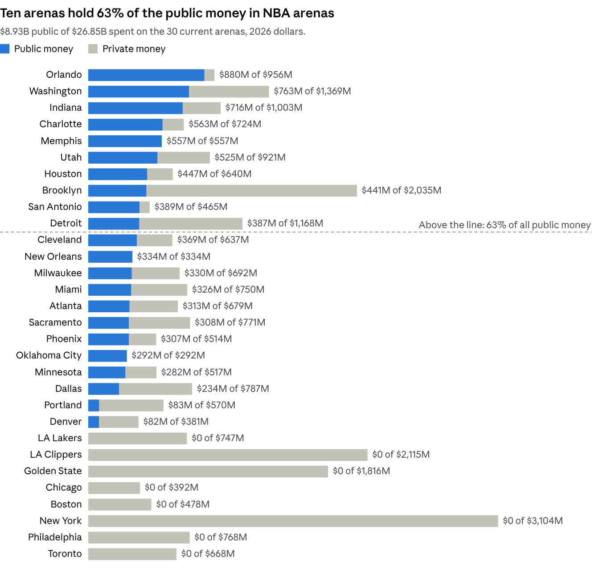
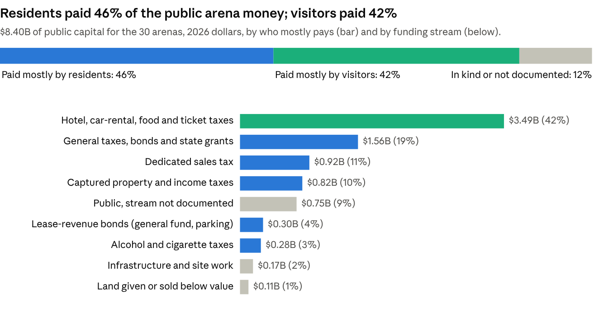

# Who Paid for the NBA's Arenas

October 11, 2026

Taxpayers have put $8.93B into today's 30 NBA arenas, a third of the $26.85B spent on them (2026 dollars). Counting property-tax exemptions and taxes redirected to arena debt, public money passes $10.6B, or 38%. Another $3.1B is committed or pending for new and rebuilt arenas in Oklahoma City, Salt Lake City, San Antonio, Portland and Memphis.

Relocation threats worked as deadlines. Of 20 documented owner or league threats since 1994, 13 were followed by public money in the same city, a median 11 months later. Deals after a threat were no more lopsided than deals without one: the public paid two-thirds to three-quarters either way.

Residents carried more of it than visitors: their sales, property and general taxes supplied 46% of public capital, against 42% from hotel, car-rental and food taxes. The research consensus is that the money does not come back in local growth.

## All 30 arenas

Eighteen of the 30 arenas are publicly owned, and the public paid half or more of everything spent on 12 of them. Of the 12 owned privately or run privately on public land, 7 still got public money or a property-tax break; we found none for Intuit Dome, Chase Center, TD Garden, Xfinity Mobile Arena or Scotiabank Arena.

Rows run from the most public money to the least; dollar amounts are charted under What taxpayers carry. Public share covers construction, later renovations and documented yearly payments, in 2026 dollars.

| Team | Arena (opened) | Owner today | Public share | Main public source | Lease ends | Exit penalty or key term |
| --- | --- | --- | --- | --- | --- | --- |
| [Orlando Magic](https://en.wikipedia.org/wiki/Kia_Center) | Kia Center (2010) | City | 92% | Hotel (tourist) tax | 2035 | Rent $1M a year |
| [Washington Wizards](https://en.wikipedia.org/wiki/Capital_One_Arena) | Capital One Arena (1997) | District of Columbia, since 2024 | 56% | General funds and bonds | 2050 | Teams committed through 2050 |
| [Indiana Pacers](https://indyencyclopedia.org/bankers-life-fieldhouse/) | Gainbridge Fieldhouse (1999) | City board (CIB) | 71% | Hotel and food taxes, state tax capture | 2044 | Up to $750M if the team leaves |
| [Charlotte Hornets](https://www.carolinajournal.com/opinion/on-world-class-chumps/) | Spectrum Center (2005) | City | 78% | Hotel and car-rental taxes | 2045 | No rent until 2030 |
| [Memphis Grizzlies](https://en.wikipedia.org/wiki/FedExForum) | FedExForum (2004) | City and county | 100% | Public bonds, split not documented | 2029 | New lease pending; $470M renovation waits on it |
| [Utah Jazz](https://www.ksl.com/article/51359287/salt-lake-city-approves-new-delta-center-lease-that-could-extend-100-years) | Delta Center (1991) | Owner's company, on city land | 57% | 0.5% city sales tax | 2055 | $125M if one team leaves, $250M if both (draft terms) |
| [Houston Rockets](https://houstonsports.org/wp-content/uploads/Multi-Purpose_Arena_Letter_of_Agreement.pdf) | Toyota Center (2003) | City-county sports authority | 70% | Hotel and car-rental taxes | 2033 | Public owner must keep it "first-class" |
| [Brooklyn Nets](https://www.ibo.nyc.ny.us/iboreports/52909AtlanticYardsTestimony.pdf) | Barclays Center (2012) | State entity, private operator | 22% | City and state land and infrastructure | Not confirmed | Not confirmed |
| [San Antonio Spurs](https://en.wikipedia.org/wiki/Frost_Bank_Center) | Frost Bank Center (2002) | County | 84% | Hotel and car-rental taxes | 2032 | Up to $124M |
| [Detroit Pistons](https://www.degc.org/_files/ugd/a7a51b_45e5bce6092b43bf9c6702781cc4fd9a.pdf) | Little Caesars Arena (2017) | City authority, Ilitch-run | 33% | Captured property taxes, school taxes included | Not public | Not public |
| [Cleveland Cavaliers](https://www.oregon.gov/das/Docs/moda-center-arena-comparable-structure-overview.pdf) | Rocket Arena (1994) | Public nonprofit (Gateway) | 58% | Alcohol and cigarette taxes | 2034 | Public owner owes major repairs |
| [New Orleans Pelicans](https://en.wikipedia.org/wiki/Smoothie_King_Center) | Smoothie King Center (1999) | State | 100% | Hotel taxes and state funds | 2029 | Lease ends June 30, 2029 |
| [Milwaukee Bucks](https://docs-preview.legis.wisconsin.gov/misc/lfb/informational_papers/january_2021/0018_local_professional_sports_facilities_financing_informational_paper_18.pdf) | Fiserv Forum (2018) | Public district | 48% | State and county funds, hotel taxes | 2046 | $553M, falling to $20M |
| [Miami Heat](https://www.miaminewtimes.com/news/the-heats-hot-air-6356397/) | Kaseya Center (1999) | County | 43% | County land plus yearly payments | 2040 | County pays $6.4M a year |
| [Atlanta Hawks](https://law.marquette.edu/assets/sports-law/pdf/sports-facility-reports/sfr-v13-nba.pdf) | State Farm Arena (1999) | Public authority | 46% | Car-rental and hotel taxes | 2046 | Up to $200M |
| [Sacramento Kings](https://en.wikipedia.org/wiki/Golden_1_Center) | Golden 1 Center (2016) | City | 40% | Parking-backed lease-revenue bonds | 2051 | Minimum rent $406.2M over 35 years |
| [Phoenix Suns](https://www.sportsbusinessdaily.com/Daily/Issues/1995/02/14/Facilities-Venues/STATE-OF-THE-ARENA-AMERICA-WEST-ARENA.aspx) | Mortgage Matchup Center (1992) | City | 60% | Hotel and car-rental taxes | 2037 | Up to $200M |
| [Oklahoma City Thunder](https://en.wikipedia.org/wiki/Paycom_Center) | Paycom Center (2002) | City | 100% | City sales tax | 2050 | Over $1B (new arena lease) |
| [Minnesota Timberwolves](https://www.lrl.mn.gov/guides/target.aspx) | Target Center (1990) | City | 55% | City bonds and sales tax | 2035 | $50M |
| [Dallas Mavericks](https://www.bondbuyer.com/news/dallas-to-retire-final-piece-of-arena-debt-16-years-early) | American Airlines Center (2001) | City | 30% | Hotel and car-rental taxes | 2031 | Team pursuing a new arena |
| [Portland Trail Blazers](https://en.wikipedia.org/wiki/Moda_Center) | Moda Center (1995) | City, since 2024 | 15% | City purchase; state bonds pending | 2030 | Must repay city money if it leaves |
| [Denver Nuggets](https://renewdenver.org/projects/pepsi-center/) | Ball Arena (1999) | Private (Kroenke) | 21% | Tax increment and infrastructure | Owns building |  |
| [Los Angeles Lakers](https://en.wikipedia.org/wiki/Crypto.com_Arena) | Crypto.com Arena (1999) | AEG, on city land | 0% counted | City land | Owner-run |  |
| [LA Clippers](https://commercialobserver.com/2020/09/los-angeles-inglewood-clippers-win-unanimous-approval-to-purchase-land-for-1-8-billion-nba-arena) | Intuit Dome (2024) | Private (Ballmer) | 0% | None found | Owns building |  |
| [Golden State Warriors](https://en.wikipedia.org/wiki/Chase_Center) | Chase Center (2019) | Private | 0% | None found | Owns building |  |
| [Chicago Bulls](https://encyclopedia.chicagohistory.org/pages/1285.html) | United Center (1994) | Private (Reinsdorf and Wirtz families) | 0% counted | Property-tax breaks, not quantified | Owns building |  |
| [Boston Celtics](https://en.wikipedia.org/wiki/TD_Garden) | TD Garden (1995) | Private (Delaware North) | 0% | None found | 2036 |  |
| [New York Knicks](https://www.ibo.nyc.gov/assets/ibo/downloads/pdf/economy-and-employment/2023/2023-march-description-of-public-subsidies-for-madison-square-garden-yankee-stadium-citi-field-and-barclays-center.pdf) | Madison Square Garden (1968) | Private (MSG) | 0% counted | Property-tax exemption, $42M a year | Owns building |  |
| [Philadelphia 76ers](https://en.wikipedia.org/wiki/Xfinity_Mobile_Arena) | Xfinity Mobile Arena (1996) | Private (Comcast Spectacor) | 0% | None found | 2031 | Team plans a new arena about 2031 |
| [Toronto Raptors](https://www.scotiabankarena.com/venue-information/history) | Scotiabank Arena (1999) | Private (MLSE) | 0% | None documented | Owns building |  |

Most construction costs come from press and secondary sources. Public figures for Milwaukee, Sacramento, Detroit, Denver, Houston, Indianapolis, New Orleans and DC come from primary documents. "0% counted" means a tax break exists but sits outside the core total.

## How the money was raised

Public arena money reaches teams through seven channels. The biggest run on taxes most voters never see, and several are built to keep a federal tax break or to stay out of the players' share of league revenue.

| Channel | How it works | NBA example | Latest verified figure |
| --- | --- | --- | --- |
| Dedicated sales tax | A new local sales tax pledged to arena bonds | Jazz: Salt Lake City 0.5% tax ([Utah Tax Commission](https://tax.utah.gov/sales/distributions/)) | $57.99M collected in FY2026 |
| Visitor taxes | Hotel, car-rental and food taxes routed to an arena district | Bucks: Wisconsin Center District ([Legislative Fiscal Bureau](https://docs-preview.legis.wisconsin.gov/misc/lfb/informational_papers/january_2021/0018_local_professional_sports_facilities_financing_informational_paper_18.pdf)) | $49.97M in 2025, 62% from hotel rooms |
| Tax increment | Future property taxes captured for arena debt, school taxes included | Pistons: Little Caesars Arena ([Detroit DDA](https://degc.org/post/downtown-development-authority-completes-major-bond-refinance)) | $30.0M paid into the bond fund in FY2024 |
| Players' income tax | State income tax paid by players, visiting players included, sent to the team or an arena fund | Pelicans ([Louisiana auditor](https://lla.la.gov/publicreports.nsf/0/ae49cb44840fe57986258b0900722bdf/$file/0000454ba.pdf)); Blazers ([Oregon SB 1501](https://olis.oregonlegislature.gov/liz/2026R1/Downloads/MeasureDocument/SB1501/Enrolled)) | $2.56M to the Pelicans in FY2023 |
| Operating payments | Annual public cash to the team for running a public building | Pacers ([Indianapolis CIB audit](https://www.in.gov/sboa/WebReports/83950A.pdf)) | $12.71M in 2023, plus $2M of Pacers loans forgiven |
| Tax-exempt bonds | A federal subsidy: interest is tax-free when general taxes, not arena revenue, repay the debt | Jazz: about $900M of Salt Lake City district bonds, 2025 ([bond notice](https://www.utah.gov/pmn/files/1261183.pdf)) | About $13.5M a year in federal cost (estimate, [Brookings method](https://www.brookings.edu/wp-content/uploads/2016/09/gayerdrukkergold_stadiumsubsidies_090816.pdf)) |
| Land and property tax | $1 land leases, exemptions and assessment cuts | Bulls and Blackhawks: United Center appeal ([Cook County Board of Review data](https://datacatalog.cookcountyil.gov/resource/7pny-nedm.json)) | Main arena parcel cut from $29.3M to $12.6M assessed value in 2024 |

Five loopholes show up again and again:

- **Pledge taxes, not rent.** Federal law since 1986 denies tax-exempt status when arena revenue repays the debt, so cities pledge sales, hotel or property taxes instead. Golden 1 Center's $272.9M, repaid partly by the Kings, was sold as taxable debt.
- **Keep it out of the players' share.** The 2023 labor contract excludes construction money and relocation inducements from shared revenue, and lets New Orleans and Memphis keep player-tax payments outside it ([CBA, Art. VII §1(a)](https://imgix.cosmicjs.com/25da5eb0-15eb-11ee-b5b3-fbd321202bdf-Final-2023-NBA-Collective-Bargaining-Agreement-6-28-23.pdf)).
- **Let the beneficiary run the borrower.** Three of five trustees of Salt Lake City's arena bond district are executives of SEG, the Jazz owner's company. On June 17, 2025 two of them moved and seconded the district's reimbursement agreement with SEG, which passed unanimously ([minutes](https://www.utah.gov/pmn/files/1368579.pdf)).
- **Write off the purchase.** Buyers deduct most of a franchise's price over 15 years. The House voted in 2025 to halve that deduction; the final law dropped the cap, and MLB's lobbyist was the only one on record on it ([House lobbying filings](https://lobbyingdisclosure.house.gov/)).
- **Write in an upgrade clause.** Leases such as Houston's Toyota Center require the public owner to keep the building "first-class, state of the art," which turns aging arenas into new public bills.

## What taxpayers carry

The public money is concentrated: ten arenas hold 63% of it. The four costliest buildings, in New York, the Los Angeles area, San Francisco and Brooklyn, were built mostly with private money.

*Funding ledger compiled for this report from audits, bond documents and press. 30 current arenas, 2026 dollars (CPI-U). Data: [arena_ledger.csv](../data/ledger/arena_ledger.csv).*

The $8.93B leaves out public money that never shows up as a check. Federal taxpayers add about $1.32B (present value) by exempting arena bond interest from tax. New York has excused Madison Square Garden from property tax since 1982, about $42M a year ([NYC Independent Budget Office](https://www.ibo.nyc.gov/assets/ibo/downloads/pdf/economy-and-employment/2023/2023-march-description-of-public-subsidies-for-madison-square-garden-yankee-stadium-citi-field-and-barclays-center.pdf)).

DC extended Capital One Arena's tax exemption to 2050. Its own finance office valued the tax relief at $312.7M and found it "not financially necessary" ([DC CFO](https://cfo.dc.gov/sites/default/files/dc/sites/ocfo/publication/attachments/TAFA_Capital%20One%20Arena%20112624.pdf)). Counting exemptions and the property tax redirected to Barclays Center's bonds lifts the public total past $10.6B.

*Same ledger. Public capital (construction, purchases, renovations) by funding stream, 2026 dollars. Totals: [totals.txt](../data/ledger/totals.txt).*

Visitor taxes are not free money. A hotel tax pledged to an arena cannot fund anything else, and residents pay it too when they stay in town.

Spread over the households that pay, the biggest commitments run to thousands of dollars each (total public money, not per year):

| Deal | Paying jurisdiction | Per household |
| --- | --- | --- |
| Delta Center and its district (2025) | Salt Lake City | $9,099, an upper bound: 30% or more of the tax comes from non-residents |
| Thunder's current and new arenas | Oklahoma City | $3,934 |
| Capital One Arena, since 1997 | District of Columbia | $2,315 |
| Kia Center | Orange County, Florida | $1,571, mostly tourist tax |
| Golden 1 Center | Sacramento | $1,549 |
| Spectrum Center | Charlotte | $1,476 |

The payments continue for decades after opening. Documented yearly subsidies to five teams already total $524M, led by Indianapolis's payments to the Pacers ([CIB audit](https://www.in.gov/sboa/WebReports/83950A.pdf)). Louisiana has budgeted $17.68M of Pelicans "lease entitlements" for FY2027 ([Louisiana Senate](https://www.senate.la.gov/FiscalServices/Presentations/2026/01%20-%20124%20LSED%20FY%2027%20FINAL.pdf)).

## Relocation threats and what they bought

Threats worked as a deadline more than a discount. Of 20 documented owner or league threats since 1994, 13 were followed by public money in the same city, a median 11 months later. In four more, the team left and the new city paid.

Threat deals were not more lopsided. After a threat, the median deal was $340M in 2025 dollars and 64% public; without one, $239M and 76% public. Neither gap is statistically meaningful (p = 0.70 and 0.52), so the public paid about two-thirds to three-quarters either way.

| Year | Team and owner | The threat | Public money that followed (nominal) |
| --- | --- | --- | --- |
| 2023 | [Wizards and Capitals, Ted Leonsis](https://www.usatoday.com/story/sports/2023/12/12/washington-wizards-capitals-virginia-relocation-possible/71900930007/) | Announced a Potomac Yard, Virginia arena with Gov. Glenn Youngkin on Dec. 13; Virginia's Senate blocked it | DC $515M, approved unanimously on April 2, 2024 ([Axios](https://www.axios.com/local/washington-dc/2024/04/03/capital-one-arena-deal-approved)); teams stay through 2050 |
| 2018 | [Suns, Robert Sarver](https://hoopsrumors.com/2018/12/sarver-threatens-to-move-suns-to-seattle-or-vegas.html) | Reported telling council members he would move to Seattle or Las Vegas; the team denied it | Phoenix $150M of a $230M renovation, 6-2 vote six weeks later ([SI](https://www.si.com/nba/2019/01/23/phoenix-city-council-approves-suns-arena-rennovation-deal)) |
| 2014 | [Bucks, Marc Lasry and Wes Edens](https://biztimes.com/nba-will-reserve-right-to-buy-bucks-back/) | Sale terms let the NBA buy the team back for $575M without an arena; the team president warned lawmakers of "Las Vegas or Seattle" ([KNPR](https://knpr.org/knpr/2015-07/will-milwaukee-bucks-find-new-home-las-vegas)) | $250M of $524.1M, passed by the Legislature with no referendum, signed Aug. 12, 2015 |
| 2013 | [Kings, Maloof family](https://www.usatoday.com/story/sports/nba/kings/2013/01/20/sacramento-seattle-maloofs-chris-hansen-sonics-supersonics/1850631/) | Agreed to sell to a Seattle group planning to move; owners rejected the move 22-8 | Sacramento about $255M toward Golden 1 Center, May 20, 2014 |
| 2011 | [Kings, Maloof family](http://www.nba.com/2011/news/03/16/kings-relocation.ap/) | Relocation talks with Anaheim; filed an "Anaheim Royals" trademark | Sacramento term sheet for $255.5M (2012), never executed |
| 2007 | [SuperSonics, Clay Bennett](https://www.espn.com/nba/news/story?id=3091416) | A co-owner said the group bought the team to move it and was fined $250,000; the team left in 2008 | Seattle paid nothing new; Oklahoma City voters approved $121.6M for its arena in 2008 |
| 2001 | [Hornets, George Shinn](https://www.espn.com/nba/news/2002/1111/1459528.html) | Left Charlotte for New Orleans after an arena referendum failed | Charlotte then approved about $260M for a new arena to win an expansion team |
| 2000 | [Rockets, Les Alexander](https://en.wikipedia.org/wiki/Toyota_Center) | After voters rejected an arena, Commissioner David Stern called relocation "certain" without one; talks with Louisville and Anaheim | $182M of $235M, approved by 66% of voters in November 2000 |
| 1996 | [Heat, Micky Arison](https://www.miaminewtimes.com/opinion/arena-winners-and-losers-alex-shoots-alex-scores-6361111/) | Threatened a move to Broward County, which his negotiators later admitted was a bluff | $38M of bayfront county land plus annual county payments, approved by voters that November |
| 1994 | [Timberwolves, Marv Wolfenson and Harvey Ratner](https://www.lrl.mn.gov/guides/target.aspx) | Agreed to sell to a New Orleans group; the NBA blocked the move | A state law for the public purchase of Target Center, about $48M |

The biggest recent deal needed no owner threat at all. Oklahoma City voters approved $900M or more, 95% of the cost, in 2023 after the mayor warned the team could leave ([PBS](https://www.pbs.org/newshour/nation/voters-in-oklahoma-city-will-decide-whether-a-new-thunder-arena-is-worth-the-investment)).

Cities that lost teams kept paying:

- **Oakland and Alameda County:** $55.7M of arena bonds were outstanding when the Warriors left in 2019. An arbitrator made the team liable for about $40M ([KTVU](https://www.ktvu.com/news/warriors-ordered-to-pay-40m-for-oracle-arena-upgrades)).
- **Kansas City:** built an arena in 2007 to attract a team and still owes about $203M on it, with no NBA or NHL tenant ([KCUR](https://www.kcur.org/post/projects-kansas-city-taxpayers-are-still-paying)).
- **Newark:** pledged $210M toward Prudential Center, where the Nets played two seasons before Brooklyn.
- **Seattle:** the Sonics' $45M settlement paid off $34.2M of remaining KeyArena debt, so taxpayers were largely spared.

The money rarely comes back. A 2023 review of more than 130 studies found a "decades-old consensus of very limited economic impacts," with benefits "well short of covering public outlays" ([Bradbury, Coates and Humphreys](https://doi.org/10.1111/joes.12533)).

## Sources

Dollar figures are converted to 2026 dollars with the BLS consumer price index (CPI-U annual averages, [FRED CPIAUCNS](https://fred.stlouisfed.org/series/CPIAUCNS)). The [funding ledger](../data/ledger/arena_ledger.csv) and [threat ledger](../data/threats/threat_ledger.csv) behind the table and charts were compiled for this report; each row carries its own source.

Primary documents:

- [2023 NBA collective bargaining agreement](https://imgix.cosmicjs.com/25da5eb0-15eb-11ee-b5b3-fbd321202bdf-Final-2023-NBA-Collective-Bargaining-Agreement-6-28-23.pdf), Article VII
- [Louisiana Legislative Auditor, stadium district audit FY2023](https://lla.la.gov/publicreports.nsf/0/ae49cb44840fe57986258b0900722bdf/$file/0000454ba.pdf) and [FY2027 Senate budget presentation](https://www.senate.la.gov/FiscalServices/Presentations/2026/01%20-%20124%20LSED%20FY%2027%20FINAL.pdf)
- [Indianapolis Capital Improvement Board audit FY2023](https://www.in.gov/sboa/WebReports/83950A.pdf)
- [Wisconsin Legislative Fiscal Bureau, Informational Paper 18](https://docs-preview.legis.wisconsin.gov/misc/lfb/informational_papers/january_2021/0018_local_professional_sports_facilities_financing_informational_paper_18.pdf)
- [Detroit Downtown Development Authority refinancing](https://degc.org/post/downtown-development-authority-completes-major-bond-refinance)
- [Utah Tax Commission sales-tax distributions](https://tax.utah.gov/sales/distributions/), [Salt Lake City district bond notice](https://www.utah.gov/pmn/files/1261183.pdf) and [June 17, 2025 board minutes](https://www.utah.gov/pmn/files/1368579.pdf)
- [Oregon SB 1501 (2026)](https://olis.oregonlegislature.gov/liz/2026R1/Downloads/MeasureDocument/SB1501/Enrolled)
- [DC Chief Financial Officer, Capital One Arena tax abatement analysis](https://cfo.dc.gov/sites/default/files/dc/sites/ocfo/publication/attachments/TAFA_Capital%20One%20Arena%20112624.pdf)
- [NYC Independent Budget Office, arena and stadium subsidies (2023)](https://www.ibo.nyc.gov/assets/ibo/downloads/pdf/economy-and-employment/2023/2023-march-description-of-public-subsidies-for-madison-square-garden-yankee-stadium-citi-field-and-barclays-center.pdf)
- [Cook County Board of Review appeals data](https://datacatalog.cookcountyil.gov/resource/7pny-nedm.json)
- [Minnesota Legislative Reference Library, Target Center](https://www.lrl.mn.gov/guides/target.aspx)
- [House Clerk lobbying disclosures](https://lobbyingdisclosure.house.gov/)

Research:

- [Bradbury, Coates and Humphreys (2023), Journal of Economic Surveys](https://doi.org/10.1111/joes.12533)
- [Gayer, Drukker and Gold (2016), Brookings, tax-exempt bonds for stadiums](https://www.brookings.edu/wp-content/uploads/2016/09/gayerdrukkergold_stadiumsubsidies_090816.pdf)

Relocation threats: the reporting is linked in the threat table above.
